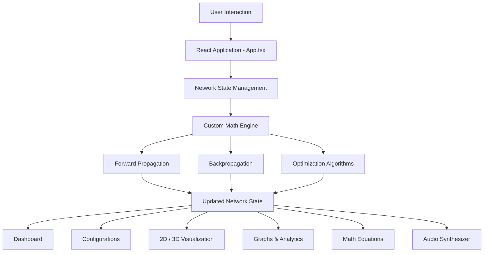
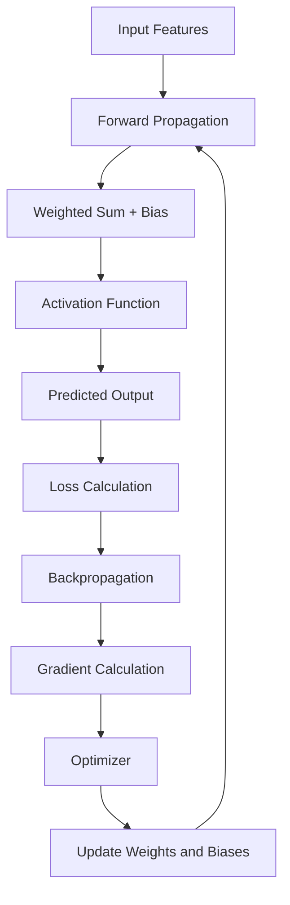

# 🧠 Neural Network Visualizer

**An Interactive, Real-Time Platform for Understanding How Neural Networks Learn**

Neural Network Visualizer is an interactive educational platform that makes the internal working of artificial neural networks transparent through real-time mathematical computation and visualization.

Built using React and TypeScript, the application implements a custom neural network mathematical engine from scratch, allowing users to explore forward propagation, backpropagation, activation functions, gradient calculations, and optimization algorithms without relying on external deep learning frameworks.

It combines interactive 2D and 3D network visualizations, mathematical equation breakdowns, performance graphs, and synthesized audio feedback to provide an intuitive learning experience.

🔗 **Live Demo:** https://neural-network-visualizer-144393663884.asia-southeast1.run.app

---

## 🌟 Overview

Neural networks are often treated as black boxes when using high-level deep learning frameworks. Although these frameworks simplify model development, they hide many of the mathematical operations happening inside the network.

Neural Network Visualizer addresses this by allowing users to inspect and experiment with the internal mechanics of a neural network.

Users can modify inputs, adjust weights and biases, change network architectures, execute training cycles, and observe how signals and gradients propagate through the network in real time.

**The primary objective is to bridge the gap between mathematical theory and practical understanding of neural networks.**

## 🎯 Problem Statement

Understanding how neural networks learn involves several mathematical concepts, including:

- Weighted sums and bias calculations.
- Activation functions and their derivatives.
- Forward propagation.
- Loss calculation.
- Backpropagation using the chain rule.
- Gradient descent and parameter optimization.

Traditional implementations often abstract these operations behind high-level APIs, making it difficult for learners to understand how individual neurons and connections contribute to the final prediction.

The project aims to solve this learning gap by providing an interactive environment where the mathematical computations and internal network states can be observed and manipulated directly.

## 💡 Proposed Solution

Neural Network Visualizer provides a browser-based computational environment with a custom TypeScript mathematical engine.

Instead of depending on TensorFlow or PyTorch for its core computations, the project implements neural network operations from scratch.

The application provides five major interactive panels:

1. **Dashboard:** Experiment with inputs, datasets, and network predictions.
2. **Configurations:** Customize network architecture and hyperparameters.
3. **Visual Architecture:** Explore the network through interactive 2D and 3D visualizations.
4. **Graphs:** Monitor training performance and decision boundaries.
5. **Math Equations:** Understand the mathematical operations using live values from the network.

---

## ✨ Key Features

### 1. Interactive Neural Network Dashboard

A central workspace for experimenting with network inputs and predictions.

- Adjust input values using interactive sliders.
- Observe real-time changes in network activations and predictions.
- Explore dynamic datasets such as sine wave orbits, Lorenz attractors, and Gaussian clusters.
- Upload custom CSV datasets containing numeric coordinates.
- View animated feedforward signal propagation.
- Inspect output probability distributions.
- Monitor activity through a live terminal console.

### 2. Network Configuration

Customize the structure and learning parameters of the neural network.

- Add or remove hidden layers.
- Adjust the number of neurons in each layer.
- Switch between ReLU, Sigmoid, Tanh, and Linear activation functions.
- Configure the learning rate.
- Select optimization algorithms: SGD, Momentum, and Adam.
- Explore how architectural and hyperparameter changes affect network behavior.
- Inspect important mathematical implementations through the embedded code viewer.

### 3. Interactive 2D and 3D Network Visualization

Explore the internal structure of a neural network through spatial visualizations.

**Features:**
- Interactive 2D network schematics.
- Custom 3D isometric neural network visualization.
- Rotate, zoom, and pan controls.
- Inspect individual neurons and synaptic connections.
- View neuron activations, pre-activation values, weights, biases, and gradients.
- Modify weights and biases directly.
- Trigger forward propagation and backward gradient animations.
- Inject random parameter perturbations to observe changes in network behavior.

### 4. Training Graphs and Performance Analytics

Visualize how the network performs and learns over training iterations.

- Real-time loss and accuracy curves.
- Training progress across epochs.
- Interactive 3D decision boundary visualization.
- Confusion matrix.
- Gradient magnitude tracking.
- Single-epoch training and continuous training controls.

### 5. Mathematical Equation Explorer

Connect neural network theory with actual computations happening inside the application.

- Explore weighted sums and bias calculations.
- Understand activation functions and their derivatives.
- Examine forward propagation equations.
- Explore Mean Squared Error (MSE) loss.
- Understand backpropagation and gradient calculations.
- Observe live substitution of network inputs, weights, and biases into mathematical equations.
- View step-by-step arithmetic breakdowns.

### 6. Audio Feedback and Animations

The application also uses the browser's native Web Audio API to provide synthesized acoustic feedback.

- Rising tones during forward propagation.
- Low-frequency sweeps during backpropagation.
- Harmonic audio feedback during training milestones.
- Sound effects for parameter perturbations.
- Toggleable audio controls.

---

## 🧮 Neural Network Concepts Implemented

The project demonstrates the fundamental mathematical operations involved in training a feedforward neural network.

| Concept | Description |
|---|---|
| Artificial Neuron | Computes weighted inputs, adds bias, and applies an activation function. |
| Weights and Biases | Control the strength of connections and activation thresholds. |
| Activation Functions | Introduce non-linearity into neural network computations. |
| Forward Propagation | Transfers input signals through network layers to generate predictions. |
| Loss Function | Measures the difference between predicted and target outputs. |
| Backpropagation | Calculates gradients using the multivariable chain rule. |
| Gradient Descent | Updates network parameters to minimize loss. |
| Optimization Algorithms | Implements SGD, Momentum, and Adam. |

### Activation Functions

The application implements four activation functions and their derivatives:

- **ReLU:** \(f(x)=\max(0,x)\)
- **Sigmoid:** \(f(x)=\frac{1}{1+e^{-x}}\)
- **Tanh:** \(f(x)=\tanh(x)\)
- **Linear:** \(f(x)=x\)

### Learning and Optimization

The mathematical engine supports:

- Stochastic Gradient Descent (SGD).
- SGD with Momentum.
- Adam (Adaptive Moment Estimation).

The implementation includes forward propagation, loss evaluation, backpropagation, gradient calculation, and parameter updates.

---

## 🛠️ Technology Stack

| Category | Technologies |
|---|---|
| Frontend Framework | React 19 |
| Programming Language | TypeScript |
| Build Tool | Vite 6 |
| Styling | Tailwind CSS v4 |
| Icons | Lucide React |
| Animations | Motion (Framer Motion) |
| Mathematical Engine | Custom TypeScript implementation |
| Visualization | SVG, HTML5 Canvas |
| Audio | Web Audio API |
| Backend (Optional) | Express.js |

### Why These Technologies?

- **React:** Provides a component-based architecture for building interactive interfaces.
- **TypeScript:** Ensures type safety for neural network structures, neuron states, connections, and mathematical operations.
- **Vite:** Enables fast development and optimized production builds.
- **Tailwind CSS:** Supports responsive layouts and consistent visual styling.
- **SVG and Canvas:** Enable lightweight, scalable network diagrams and visualizations.
- **Web Audio API:** Generates audio feedback directly in the browser.
- **Custom TypeScript Math Engine:** Provides complete visibility into neural network computations without hiding operations behind external ML libraries.

---

## 🏗️ System Architecture

The application follows a unidirectional data flow architecture.

The central React application manages the network state, while the custom mathematical engine performs computations. The individual visualization panels consume the updated state and render the corresponding results.

### Architecture Diagram



### Neural Network Learning Workflow



This workflow illustrates how predictions are generated, errors are calculated, gradients are propagated backward, and network parameters are updated during training.

---

## ⚙️ How the Application Works

### 1. Initial Network Setup

When the application starts, an initial neural network is initialized with:

- 3 input neurons.
- 1 hidden layer containing 5 neurons.
- 3 output neurons.

The hidden layer uses ReLU activation, while the output layer uses Sigmoid activation.

Network weights are initialized using normalized Xavier/He initialization as described in the implementation.

### 2. Input Experimentation

Users can modify input values using sliders or select dynamic dataset streams.

The application recalculates network activations and updates the output visualizations.

### 3. Network Customization

Users can modify the network topology, neuron counts, activation functions, and learning rate through the Configurations panel.

### 4. Forward Propagation

Input values pass through the network layer by layer.

Each neuron calculates a weighted sum, adds its bias, and applies its activation function to produce an output.

### 5. Backpropagation and Training

The network compares its predictions with the target values and calculates the loss.

Backpropagation then computes gradients for weights and biases using the chain rule. The selected optimizer updates the network parameters.

### 6. Performance Visualization

The Graphs panel displays training metrics, while the Visual Architecture panel shows how activations, weights, and gradients change.

### 7. Mathematical Exploration

The Math Equations panel connects the current network state with its mathematical formulas, allowing users to understand the calculations using live values.

---

## 📂 Project Structure

```text
Neural-Network-Visualizer/
│
├── package.json
├── tsconfig.json
├── vite.config.ts
├── index.html
│
└── src/
    ├── main.tsx
    ├── App.tsx
    ├── index.css
    │
    ├── types/
    │   └── network.ts
    │
    ├── utils/
    │   ├── mathEngine.ts
    │   └── audioSynth.ts
    │
    └── components/
        ├── DashboardPanel.tsx
        ├── ConfigurationsPanel.tsx
        ├── VisualArchitecturePanel.tsx
        ├── GraphsPanel.tsx
        └── MathEquationsPanel.tsx
```

### Important Files

| File | Responsibility |
|---|---|
| `App.tsx` | Main application and global network state management. |
| `network.ts` | TypeScript definitions for network architecture and neuron states. |
| `mathEngine.ts` | Implements activation functions, forward propagation, backpropagation, and optimizers. |
| `audioSynth.ts` | Generates audio feedback using the Web Audio API. |
| `DashboardPanel.tsx` | Input experimentation, datasets, and predictions. |
| `ConfigurationsPanel.tsx` | Network architecture and hyperparameter controls. |
| `VisualArchitecturePanel.tsx` | Interactive 2D and 3D network visualization. |
| `GraphsPanel.tsx` | Training graphs and decision boundary visualizations. |
| `MathEquationsPanel.tsx` | Mathematical formulas and live calculation breakdowns. |

---

## 🚀 Getting Started

### Prerequisites

Make sure you have installed:

- Node.js v18 or higher (v20+ recommended).
- npm v9 or higher.

### 1. Clone the Repository

```bash
git clone <YOUR_GITHUB_REPOSITORY_URL>
```

Navigate to the project directory:

```bash
cd neural-network-visualizer
```

### 2. Install Dependencies

```bash
npm install
```

### 3. Run the Development Server

```bash
npm run dev
```

Open your browser at:

```text
http://localhost:3000
```

### 4. Verify TypeScript

```bash
npm run lint
```

This executes TypeScript checking without generating output files.

### 5. Build for Production

```bash
npm run build
```

The optimized production files are generated in the `dist/` directory.

### 6. Preview the Production Build

```bash
npm run preview
```

---

## 🌐 Deployment

The Neural Network Visualizer is designed as a client-side single-page application and can be deployed using static hosting platforms.

### Supported Deployment Platforms

- Vercel
- Netlify
- Cloudflare Pages

### Deployment Configuration

| Setting | Value |
|---|---|
| Build Command | `npm run build` |
| Output Directory | `dist` |
| Recommended Node Version | 20.x |

### Docker Deployment

A basic static deployment can also be configured using Docker and Nginx.

```dockerfile
FROM node:20-alpine AS build

WORKDIR /app

COPY package*.json ./
RUN npm ci

COPY . .
RUN npm run build

FROM nginx:alpine

COPY --from=build /app/dist /usr/share/nginx/html

EXPOSE 80

CMD ["nginx", "-g", "daemon off;"]
```

---

## 🔮 Future Scope

The project can be extended with additional neural network architectures and advanced learning capabilities.

| Area | Current Implementation | Future Enhancement |
|---|---|---|
| Network Architecture | Fully connected feedforward networks | CNNs, RNNs, and LSTMs |
| Optimization | SGD, Momentum, Adam | Configurable optimizer parameters and learning-rate schedules |
| Training | Sample-by-sample training | Mini-batch training |
| Loss Functions | MSE-based training updates | Native Cross-Entropy implementations |
| Datasets | Lorenz attractors, sine orbits, Gaussian clusters, CSV | Image datasets such as MNIST |
| Performance | Browser-based TypeScript computations | WebGPU/WebGL acceleration for larger networks |

---

## ⚠️ Current Limitations

- The current network architecture focuses on fully connected feedforward neural networks.
- The supported network size is limited to seven layers and eight neurons per layer.
- Training currently uses sample-by-sample updates rather than mini-batch vectorization.
- MSE is used for core training updates; Cross-Entropy is not yet implemented as the native backpropagation loss.
- CSV uploads currently support numeric coordinate columns.
- The custom mathematical engine prioritizes educational transparency over large-scale model training performance.

---

## 🎓 Learning Outcomes

Developing this project provided practical experience with:

- Understanding neural networks from first principles.
- Implementing forward propagation and backpropagation.
- Applying the multivariable chain rule computationally.
- Implementing gradient-based optimization algorithms.
- Working with TypeScript for mathematical and computational logic.
- Building interactive 2D and 3D visualizations.
- Managing synchronized state across multiple React components.
- Connecting mathematical concepts with real-time visual representations.

---

## 👩‍💻 Author

**Karanam Charvi**

---

*Built to make neural network learning transparent, interactive, and intuitive.*
